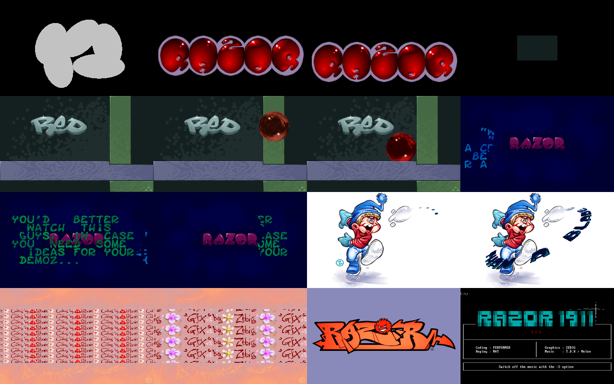

# Red — in a browser

**▶ [Watch it in your browser](https://gmegidish.github.io/demoports/Red_by_Razor_1911/)** · press **F** for fullscreen

*Red* is Razor 1911's first demo from their new demo team, released in March 1994: "an EyeBlasting MCGA Demo!" Two minutes of 320x200: a RAZOR logo blown up from a blob of grey, the RED graffiti on a stone wall with a red glass ball rolling over it, a blue RAZOR logo with text pages wiped in along a wave, a kid kicking a snowball that drags the scroller behind it, and the credits zoomed as tiles. It ends on a 640x480 RAZOR logo and the text screen. The music is "wizardry" by T.D.K. (Mark Knight), a four-channel ProTracker module, played by Mat's replay routine.

This repository rebuilds it in a browser from the original file, `RED.EXE`. The browser unpacks its PKLITE compression, puts the program in a megabyte of real-mode memory at segment 0, and runs the demo against that memory one vertical retrace at a time, as the demo's own timer interrupt does. Video goes through a VGA modelled at register level: mode 13h, the 640x480 16-colour ending and the text mode. The picture reaches the screen through the 6-bit palette and a 2D canvas. No WebGL, no libraries.

There is no source code for Red. The program was unpacked, disassembled and read. **[TECHNICAL.md](TECHNICAL.md)** explains how it works: the PKLITE compression, the memory map, the timers, the VGA registers and the formats of its pictures and text.

The whole port was written by [Claude Code](https://claude.com/claude-code): unpacking, disassembling, recording the original in an emulator to compare against, reading the parts, porting, and this README.



*Sixteen moments, in order. Rendered headless by `tools/poster.mjs`: no browser, no screenshots. The 640x480 and text frames are scaled down.*

## Run

```bash
python3 -m http.server 8000
# open http://localhost:8000/
```

| Key | Action |
|---|---|
| Click | Start |
| **F** | Toggle fullscreen |
| ← / → | Seek 5 s |

Add `#t=60` to the URL to start 60 s in, `#hud` to show the clock, `#nosound` to run on the wall clock without the soundtrack.

```bash
npm test                                         # 7 tests
node tools/shot.mjs /tmp/red 10 40 70 110        # render four moments to PNG, no browser
node tools/frames.mjs /tmp/red 1700 7472         # render recording frames by number
node tools/poster.mjs                            # renders docs/poster.png
```

## Credits

*Red*, Razor 1911, 1994. From `RAZOR.NFO` and the demo's end screen: code Performer; graphics Zebig; replay Mat; music T.D.K / Melon. All graphics and music belong to their authors.

The port, the tools and this README were written by [Claude Code](https://claude.com/claude-code).

## What is in the file

`RED.EXE` is one DOS program, 192 KB, packed with PKLITE 1.12 (the "extra" and "large" variant: literals XORed with the bit counter, matches up to 24 bytes plus an escape, 13-bit offsets). Unpacked it is 570 KB:

- **The code**, at segment 0: one straight-line main script (0000:0000..0276) that calls each effect in turn, about 70 small routines, and three huge unrolled ones generated by a tool: 3140 `mov al,[si+src] / add al,band / mov es:[di+dst],al` blocks that draw the glass ball (0000:1280), and two routines that lay the scroller's text along the snowball's path (0997:0000 and 11d9:0000).
- **The data**, in eight segments: palettes, tables, the text and the fonts in 16b2; the pictures in 2287..743a, mostly raw bytes, a few as run lengths or 2 bits per pixel.
- **The music**: "wizardry", at 824a:0000, and Mat's player at 87ba:0000, called with a function number in `ah`.

**One clock.** At start the demo times one frame with the PIT between two retraces, then reprograms the PIT to 98% of that. Its timer interrupt busy-waits for the next vertical retrace and counts a frame, so the counter ticks once per retrace, 70.09 Hz, and every effect waits on it. The music plays on its own interrupt and nothing reads it. The 640x480 ending runs after the BIOS timer is back and polls the retrace itself, at 59.94 Hz.

## The parts

Times are from the switch to mode 13h.

| Time | Part | Content |
|---|---|---|
| 0:00 | Bubbles | A grey blob animated by 91 run-length frames at 35 Hz becomes the red RAZOR bubble logo, which bounces and falls away; a rectangle grows |
| 0:11 | RED | The wall slides in, the pillar drops, the pedestal rises, the RED logo opens like a window; a red glass ball rolls and bounces over it for 18 seconds, refracting the wall; a tiled wipe |
| 0:33 | Blue RAZOR | The RAZOR logo slides in and shivers; three text pages ("-RED-", "WHOAOO IDEAS!", "YOU'D BETTER WATCH THIS...") are wiped in along a wave; a blur band; white bars |
| 1:06 | Snowball | Zebig's kid kicks a snowball; the scroller flies out of it along a curved path |
| 1:25 | Credits | "Coding by Performer", then "Gfx by Zebig", zoomed as tiles in a band; the picture splits apart |
| 1:42 | Ending, 640x480 | The RAZOR graffiti logo on lilac, then the small triangle logo, faded with the music |
| 1:57 | Text screen | The TheDraw-crunched end screen, back to DOS |

## How it was read

1. Unpack `RED.EXE` by running the PKLITE stub in Unicorn, twice at two load segments, so the difference gives the relocations (`tools/re/unpack.py`). The stub has one relocation of its own, in the `add ax,0` that computes where the unpacked image ends: without it the stub thinks it has no room.
2. Disassemble by recursive descent from the entry (`tools/re/rdis.py`).
3. Record the original in DOSBox Staging at 200000 cycles. In DOSBox the Sound Blaster replay stays silent, so the reference is a Gravis Ultrasound run. Its pictures are right; its music is not (see below).
4. Read and port the program in five slices, one per part of the main script, written down as pseudo-code in `docs/disassembly/`, each checked frame by frame against the recording while it was written. Then write the PKLITE unpacker in JavaScript from the stub (`src/pklite.js`), which reads the stub's own code tables.

## How the port works

**Not an emulator.** No x86 is interpreted. Each routine was rewritten in JavaScript from the listing, but the data stays where the original kept it. The page loads `RED.EXE`, unpacks it, and copies the image into a 1 MB `Uint8Array` at segment 0, so every address in `docs/disassembly/` is the address in the port: `16b2:0200` is `m.mem[0x16b20 + 0x200]`. Tables, pictures, the text and the variables are read and written in place. The three unrolled routines are not copied by hand: at load time the port decodes their instruction bytes into tables of source offset, band and destination, and refuses anything it does not recognise.

**One generator per part.** The original's routines spin on the frame counter. In the port each part is a generator, and `yield` stands for that wait. `src/demo.js` drives the main script one retrace at a time: latch the display registers, count a frame as the timer interrupt does, resume the script until its next wait. Seeking forward runs the retraces in between; the whole demo takes about a second. Seeking back starts again from the beginning.

**A VGA at register level.** `src/vga.js` and `src/screen.js` come from the [GBU port](../The_Good_the_Bad_and_the_Ugly_by_Surprise_Productions): four planes, sequencer, graphics controller, CRTC, attribute controller and DAC, with the 6-bit DAC scaled to 8 bits as DOSBox does, so frames compare byte for byte with the recording. The refresh rate comes from the CRTC: 70.09 Hz in mode 13h, 59.94 Hz in mode 12h. The text screen is drawn with the VGA BIOS font, and its cursor blinks every 16 frames.

**Music as a clock, not a synthesiser.** The port does not play the MOD in the browser. The soundtrack is the module rendered with libopenmpt, and the page runs the demo up to the audio's `currentTime`. The music never steers the picture, so only its start had to be placed: 44 ms after the mode switch, where it starts in the recording.

**The soundtrack is not the recording's audio.** In the DOSBox recording the song plays 2.1 times too fast: it comes round again after 47.6 s instead of 100. Mat's Ultrasound replay times a tick with the card's two timers, timer 2 (320 µs units) for most of the 20 ms and timer 1 (80 µs) for the rest, switching between them in its interrupt. DOSBox's emulation most likely mishandles that hand-off and ticks too often; the cause in DOSBox was not traced. So the soundtrack is "wizardry" rendered by libopenmpt at the module's own tempo (125 BPM, 50 Hz ticks), with the replay's hard left/right panning and linear interpolation, looped once as the replay loops it, and the ending's fade applied: 04b6 lowers the player's volume from 100h to 80h over its 64 retraces before the music stops.

## What is verified, and what is not

Verified:

- **Against the original running, every frame:** the port was compared with all 7171 mode 13h frames, all 879 frames of the 640x480 ending and 200 frames of the text screen of the recording. Every one is identical, byte for byte, the cursor included. `test/original.test.js` checks eleven of them in one run of the whole demo.
- **The unpacker:** `src/pklite.js` gives the same image, byte for byte, as the PKLITE stub running in an emulator.

Not the same as the recording, or not derived from the code:

- **Fitted timing in the ending.** The 640x480 part waits for the retrace by polling a status bit that is set for only two lines. In the recording it misses five retraces in three places, most likely while the music player's interrupt runs across the pulse. The port waits the same five retraces, as named constants in `src/parts/ending.js`.
- **The start.** How many retraces the frame measurement takes before the first frame counts is fitted (one), and the part before it, loading the module into the Ultrasound, is not shown: the recording and the port start at the mode switch.
- **The DOS prompt.** The recording shows `C:\>` under the end screen: COMMAND.COM prints it after the demo exits. The port draws it too.
- **Music.** The soundtrack is libopenmpt playing the module, not Mat's replay: the mixing, the volume curve of the final fade (taken as linear) and the exact timing of each tick are libopenmpt's. The music starts and stops where it does in the recording.
- **Sound Blaster.** The demo supports SB and SB Pro too; in DOSBox they stay silent, so they were not compared.

## Layout

```
index.html              the page
src/main.js             fetches RED.EXE and the soundtrack; runs the demo on the soundtrack's clock
src/pklite.js           unpacks RED.EXE (PKLITE 1.12, extra + large)
src/demo.js             the main script and the retrace-paced frame loop
src/machine.js          the real-mode memory, the frame counter and its wait
src/vga.js              the VGA at register level
src/screen.js           what the monitor shows, from the registers
src/parts/bubbles.js    the bubble logo
src/parts/redLogo.js    the RED logo and the glass ball
src/parts/razorText.js  the blue RAZOR logo and the text pages
src/parts/snowball.js   the kid and the snowball scroller
src/parts/credits.js    the credit tiles
src/parts/ending.js     the 640x480 logos and the text screen
assets/soundtrack.ogg   the module rendered by libopenmpt
assets/vgafont.bin      the VGA BIOS 8x16 font
docs/disassembly/       the notes the port was written from
tools/re/               the unpacking and disassembly tools
tools/*.mjs             render moments, frames and docs/poster.png headless
```
