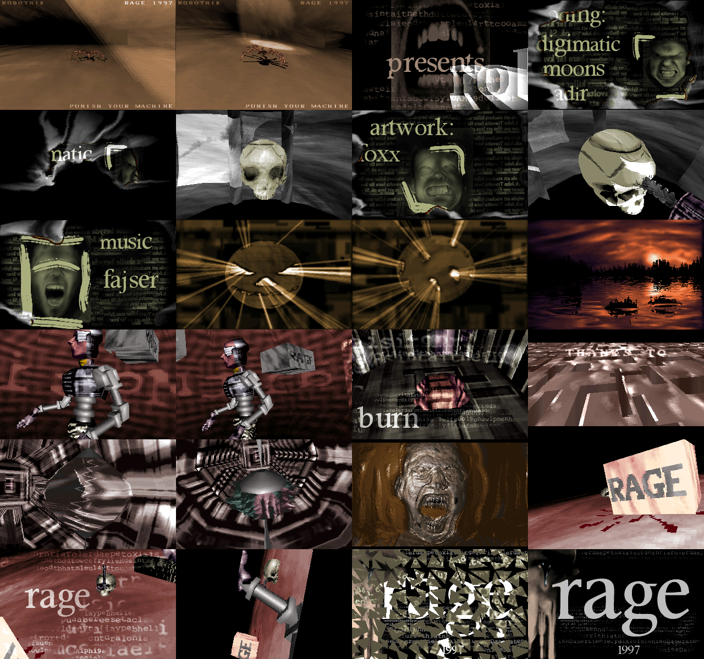

# Robotnik — in a browser

**▶ [Watch it in your browser](https://gmegidish.github.io/demoports/Robotnik_by_Rage/)** · press **F** for fullscreen

*Robotnik* is a PC demo by Rage, released at The Gathering 1997 (the maze part spells it out: "the gathering 97", "thanks to midas, sahara surfers"). It runs six and a half minutes on two tracker songs: an intro with a spider in a spotlit cave, three credit pictures that burn away into smoke and two skulls lit by a slide projector, then a loading screen, and the demo itself: a ball throwing light rays, a sunset over water, a robot dancing in front of a mirror, a falling cloth, a maze flown over by words, a mechanical tunnel with a chrome pod, a face drowning in liquid, and the robot dead on a floor of flesh.

This repository rebuilds it in a browser from the original executable. `ROBOTNIK.EXE` carries everything except the rendered music: the program, both songs, 3D objects, camera recordings and pictures, packed behind the program. The port reads them straight out of it. The picture is made the way the original made it: a 320x200 buffer of palette indices and a 6-bit VGA palette, software-rendered on the CPU, put on screen by a 2D canvas. No WebGL, no libraries.

There is no source code for Robotnik. Everything was read out of the executable.

The whole port was written by [Claude Code](https://claude.com/claude-code): unpacking the executable, disassembling it, recording the original in an emulator, reading the code in twelve slices, checking the readings against the recording and against the machine code run in an emulator, porting, and this README.



*Twenty-four moments, in order. Rendered headless by `tools/poster.mjs`: no browser, no screenshots.*

## Run

```bash
python3 -m http.server 8000
# open http://localhost:8000/
```

| Key | Action |
|---|---|
| Click, Enter or Space | Start |
| **F** | Toggle fullscreen |
| ← / → | Seek 5 s |

Add `#t=200` to the URL to start 200 s in, `#hud` to show the clock.

```bash
npm test                                   # 60 tests, about fifteen seconds
node tools/shot.mjs /tmp/robotnik 30 200   # render moments to PNG, no browser
node tools/poster.mjs                      # renders docs/poster.png
```

## Credits

*Robotnik*, Rage, 1997. From the demo's own credit pictures: code by digimatic, moons and nadir, graphics by foxx, music by fajser. Music player: MIDAS Sound System 0.6, by Sahara Surfers. All graphics and music belong to their authors.

The port, the tools and this README were written by [Claude Code](https://claude.com/claude-code).

---

# How it was made, and how it was unmade

## A program with a tail

`ROBOTNIK.EXE` is 2,545,734 bytes. The front is ordinary: Watcom's DOS/4GW stub, and at 0x2c90 a Linear Executable with three objects: code at 0x10000, a small writable segment at 0x70000 that turns out to hold hand-written assembly, and data at 0x80000. The LE ends at 0x80e46. Two megabytes follow it.

The last dword of the file is the size of a directory at its end: 93 entries of 26 bytes, a 13-byte name, a method byte, the size, an offset counted back from the end of the file, and the packed size.

```
0026ced0: 7075 6c6c 6d61 782e 786d 0000 0001 a5e0  pullmax.xm......
0026cee0: 0500 00ca 1e00 4075 0300 6265 7267 626f  ......@u..bergbo
```

Ninety of them are packed with method 1 of a small compression library linked into the program (dispatcher at 0x4a360, decoder at 0x5528c): LZSS with a flag byte per eight items, least significant bit first, and a big-endian word per match that copies `(w >> 12) + 2` bytes from `(w & 0xfff) + 1` back. The first file shows it plainly, the text of an XM header broken by flag bytes:

```
00080e46: 00 "Extended" 00 " Module:" 80 " Agurk " c000 ...
```

`src/archive.js` is the reader, thirty lines. `src/le.js` loads the program the way DOS/4GW does, relocations applied, so the port can read its tables and built-in objects at the addresses the disassembly uses.

## Sixteen positions

The help text the program prints for a bad switch gives the structure away: `/sn   start at position n, 0..13 (run entire demo for proper synchronization)`. The sequencer at 0x123f0 runs sixteen parts, each an init, a run and a deinit. Positions 0 to 6 play on `pullmax.xm`, then the song is freed, "WAITING FOR ROBOTNIK..." goes up in a grey half-size font while `bergborr.xm` loads, and positions 7 to 15 play on it.

Nothing waits for seconds. MIDAS calls the demo's timer callback once per vertical retrace, 70.086 times a second in mode 13h, and the callback counts frames. Two tables in the data segment, at 0x80058 and 0x801b8, list song positions and rows, 21 for the intro and 38 for the demo. A part waits until the song reaches its first entry, sets the frame counter to `row * 49 / 5` (9.8 frames to a 0.14-second row), and steps on the entries after it: the spotlight switches on at entry 2, the RAGE cube falls at entry 3, the spider part ends at 4. The port does the same with the rows of the songs, read from the XM files by `src/xm.js`.

## Twelve readers

The code was read in twelve slices, each by its own agent, each writing notes a porter could implement from without going back to the assembly: the 3D library's data side and its renderer, the main program and its helpers, and nine slices of parts. They are in `docs/disassembly/`. Wherever it could be done, the reading was checked by running the original code in Unicorn against a Python model of the reading, on thousands of random inputs: every rasteriser the shipped data selects, the shade-table generator, the cloth simulator, the maze and face renderers, the near-plane clipper and the sort. Then the parts were ported against those notes and against the recording.

## The engine

The 3D library carries the names of its source files in its asserts: `object.c`, `doobj.c`, `gfx3.c`, `readtddd.c`. The last one is a reader for Imagine's TDDD object format, and nothing calls it. The objects in the archive, `spider.eob`, `logo.eob`, `skull.eob` and `en_obj.eob`, are raw dumps of the structures the reader would have built: a 0xb4-byte object header, then points in 16.16, triangles of 0x30 bytes with their texture coordinates, face and corner normals as unit vectors times 255, materials, keyframes, and the sibling and child subtrees after it. Loading them is reading memory back.

Matrices are built in floating point from Euler angles of 4096 steps to the turn, then cut to 8.8 fixed point; points are transformed in integers, projected with a focal length of 256 around (159, 99), clipped at z = 50, culled, sorted with a quicksort on average or maximum depth, and drawn by the routine each material names: flat, phong through a 128x128 radial map, texture, texture times phong, perspective-correct texture. Five of those share one compiled C template, and their quirks came along: both span ends are drawn, row 200 is written past the end of the buffer, a carry out of the packed u coordinate spills into v.

One quirk took a frame-by-frame comparison against the original running in the emulator to find. The phong-and-flat routine at 0x44354 closes its outline by copying corner 0 into slot n of the polygon record itself. When a four-cornered polygon cut by the near plane is drawn as a fan of triangles, that copy lands in the fourth corner's slot before the second triangle is drawn: the original draws (0,1,2) and then (0,2,0), a triangle of no area, and the fourth corner is never drawn. The tunnel's spikes show it when they cross the camera.

There is a second, smaller engine: two-dimensional triangles with a span filler in the writable segment that patches its own texture and row addresses into its code. The screen shatters with it at the end of the skull part, the face and the end pictures, 532 triangles cut from a jittered grid and thrown at the viewer.

## Effects

The skull parts are shadow mapping. A second camera, a slide projector with its own recording, renders the scene into a depth buffer; each pixel of the normal render that the projector sees gets the film's light, a mouth from `teeth.rap`, 36 frames of 4-bit grey played back and forth. The tag in the depth buffer's top byte is a frame number, so it only needs clearing every 256 frames.

The spider's shadow is each of its triangles projected from the light onto the floor and drawn through the darkening row of the blend table; the cone of light is a 2D triangle from the light's screen position; the disc of light on the floor is subtracted and added again in the floor's own texture each frame, until the blood is stamped into it.

The cloth is a 16 by 16 mass-spring grid with twelve springs per particle, pinned to an 8x8 block in the middle by `cl_heigh.raw`, the wind four sines on its corners. The robot's mirror is a second render from the mirror's centre, aimed with the law of cosines. The tunnel is six copies of one generated segment, the pod a lathe, its chrome a render from inside it wrapped around it. The maze is not voxels: a perspective floor whose walls are pixels that copy the one above them when the light lookup comes back empty.

## Bugs, kept

- Part 8's start wait compares the sync index with the address of the function that returns it, so it never waits.
- Part 12 clears 256 entries of tables that have 200 and 128: the first entries of the lightning's path become zero, and so do the pod's corner normals, which changes how its spikes are shaded.
- Part 12 sets the small engine's row clip to 0..255 and never sets it back; the shatters after it run with it.
- Part 10 frees the back of its opening picture twice. The floor of the end scene has one point at x = 600 where its neighbours suggest something else.
- Several parts read past their buffers into whatever follows. The port keeps the original's memory layout where the reads land in its own buffers, and reads zero where they land in memory nothing describes.

## Measuring the original

The original was recorded in DOSBox Staging (S3, 200,000 cycles, Sound Blaster 16) from the switch to mode 13h to the return to text mode: 401.8 seconds, 28,162 frames, with sound. The port was compared against it frame by frame.

Many of the loops never wait for the timer. They draw as fast as the machine allows and move things by the frames elapsed, but some move things per pass: the drill in the skull part, the spider's walk, the cloth's simulation steps, the smoke of the credits. How far those get depends on how fast the machine was. For those parts the ports recover from the recording, pass by pass, which tick each picture was drawn on, and play them on that schedule; the drill travels 4,455 units in the recording, and would travel 30,888 at a pass per frame.

The recording has one property the port leaves out. In DOSBox the songs played a quarter of a percent fast against the 70 Hz frames, so the music's sync points drift earlier and earlier against the picture: by a few hundredths of a second at the start of each song, by more than a third of a second at the end of the demo. The port keeps real hardware time: the music at its speed, the frames at 70.086 per second. The tests compare each moment with the recording frame that shows the same state.

DOSBox also does not apply the 24-bit precision main sets on the FPU: the cloth only matches the recording with intermediate results kept at full precision.

## What is verified, and what is not

- The engine's rasterisers, clipper, sort, projector and small triangle engine match the original code run in Unicorn, pixel for pixel, on random inputs and posed scenes (`test/engine.test.js`, fixtures from `tools/re/engine_fixtures.py`).
- Every part has recording frames in `test/parts.test.js`: most are pixel-identical, the lowest is 96% (the robot sinking at the end of part 9, where the recording's skew moved the sync point against the camera path).
- Frames match where the recording shows a whole frame at the moment the port draws. DOSBox often showed a frame for two or three refreshes, or tore a copy across two; those don't match one for one.
- Not reproducible: the sunset's rocks are placed by a generator seeded from the timer, the light rays and glow trails of part 7 depend on the machine's speed in ways a schedule only approximates, and the TV and mirror feedback of part 9 depend on its render cadence.

## How the port works

`src/demo.js` is the sequencer. Each part is a generator that yields once for every frame it shows; the browser sets the clock from the audio element before each step, so a part sees the frame counter and the song position the original would have seen. `src/machine.js` is the PC as the demo sees it: video memory, the DAC, the timer and MIDAS's play status.

## Layout

| Path | What |
|---|---|
| `index.html`, `src/main.js` | The page: loads `ROBOTNIK.EXE` and `assets/music.ogg`, drives the demo from the audio clock |
| `src/archive.js`, `src/le.js`, `src/files.js` | The appended archive and the program image |
| `src/demo.js`, `src/machine.js`, `src/sync.js`, `src/xm.js` | Sequencer, machine, sync tables, song rows |
| `src/screen.js`, `src/textscreen.js`, `src/font.js`, `src/gfx.js` | Output, text mode, the demo's font, shared image helpers |
| `src/engine/` | The 3D library: objects, keyframes, worlds, transform, clip, sort, rasterisers, projector, triangle engine, recordings |
| `src/shatter.js` | The screen shatter |
| `src/parts/` | The sixteen parts |
| `assets/music.ogg` | Both songs rendered with libopenmpt, placed where the recording has them |
| `docs/disassembly/` | The readers' notes |
| `tools/re/` | Unpacking, disassembly, recording and comparison tools (`tools/re/README.md`) |
| `test/` | Unit, engine and recording tests |
