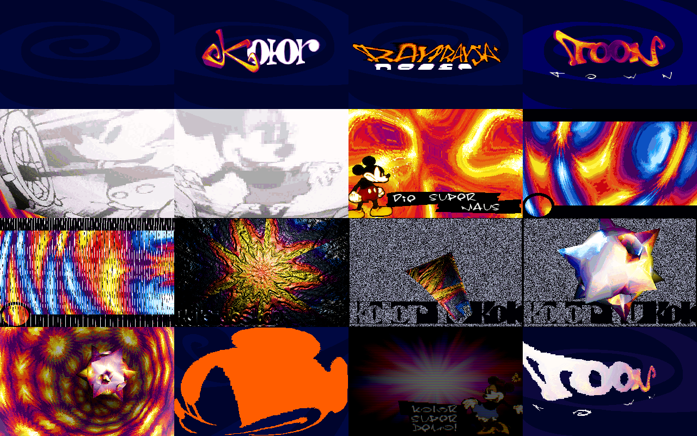

# Toontown — in a browser

**▶ [Watch it in your browser](https://gmegidish.github.io/demoports/Toontown_by_Kolor/)** · press **F** for fullscreen

*Toontown* is a PC demo by Kolor, released at Mekka & Symposium 1997. It runs four and a quarter minutes, all of it cartoons: a dark spiral with the Kolor logo and the credits, the TOON town logo, black-and-white Mickey film frames bent over a tunnel, "Die Super Maus" over a plasma, rings and flashes, a kaleidoscope, a spiky star over noise and then in a tunnel, red Mickey silhouettes, Minnie in "faked highcolor", and the TOON logo swaying back into the spiral. The music is "toon town" by Raytrayza, an eight-channel FastTracker 2 module.

This repository rebuilds it in a browser from the original files: `TOONTOWN.EXE`, `TOONTOWN.DAT` and `TOONTOWN.XM`. The browser unpacks the program, loads its pictures and tables, and runs the demo one vertical retrace at a time, 70 a second, as the demo's own retrace callback does. Video goes through a VGA modelled at register level: mode 13h, the 320x400 "FakeMode" and the text screens. The picture reaches the screen through the 6-bit palette and a 2D canvas. No WebGL, no libraries.

There is no source code for Toontown. The program was unpacked, disassembled and read.

The whole port was written by [Claude Code](https://claude.com/claude-code): unpacking, disassembling, recording the original in an emulator to compare against, reading the parts with six agents in parallel, porting, and this README.



*Sixteen moments, in order. Rendered headless by `tools/poster.mjs`: no browser, no screenshots. The 320x400 FakeMode frame is scaled down.*

## Run

```bash
python3 -m http.server 8000
# open http://localhost:8000/
```

| Key | Action |
|---|---|
| Click | Start |
| **F** | Toggle fullscreen |
| ← / → | Seek 5 s |

Add `#t=60` to the URL to start 60 s in, `#hud` to show the clock, `#nosound` to run on the wall clock without the soundtrack.

```bash
npm test                                             # 4 tests, ~20 s
node tools/shot.mjs /tmp/tt 10 60 120 200            # render four moments to PNG, no browser
node tools/frames.mjs /tmp/tt 3400 14650             # render recording frames by number
node tools/poster.mjs                                # renders docs/poster.png
```

## Credits

*Toontown*, Kolor, 1997. From `INFOFILE`: code blackaxe and fontex; music and graphics raytrayza; "walt disney felt like doing some extra graphics"; the object by scavenger; support scot. The sound system is MIDAS 0.6 by Petteri Kangaslampi and Jarno Paananen, the DOS extender PMODE/W by Daredevil and Tran. All graphics and music belong to their authors.

The port, the tools and this README were written by [Claude Code](https://claude.com/claude-code).

## What is in the files

- **`TOONTOWN.EXE`**, 135 KB: a PMODE/W 1.32 stub and a PMW1 program, a Watcom C/C++ 32-bit executable packed by PMWLITE. Unpacked it is one 470 KB object (179 KB of code and data, the rest uninitialised): the demo, Watcom's runtime and MIDAS.
- **`TOONTOWN.DAT`**, 1.2 MB: no directory. The program seeks to fixed offsets: 28 PCX pictures, the 39 frames of the spiral animation (PCX too, offsets in a table in the program), a 24-bit TGA (Minnie, for the high-colour part) and a raw table.
- **`TOONTOWN.XM`**: the module. Its `W01` commands are MIDAS syncs: the demo counts them and some parts move on them.

**One clock.** MIDAS measures the display's refresh rate, synchronises its timer to it and calls the demo back at every vertical retrace: a counter goes up by one, 70.09 times a second. Every part renders a picture into a buffer, waits for the counter to change, copies the buffer to the screen, and advances its animation by the number of retraces that passed. On a slow PC it skips ahead, on a fast one it renders every retrace. Each part runs until MIDAS reports that the song reached a given position; main then calls the next.

## The parts

Times are from the switch to mode 13h.

| Time | Part | Content |
|---|---|---|
| 0:00 | Spiral | The dark-blue spiral, played backwards from its last frame, fades in |
| 0:10 | Kolor | The Kolor logo over the spiral |
| 0:20 | Credits | blackaxe, fontex, raytrayza and scot, each zoomed in over the spiral |
| 0:41 | TOON town | The TOON town logo pulses and fades |
| 0:56 | Film | Five frames of black-and-white Mickey film on a grid bending over a tunnel, dissolving into each other, then a plasma |
| 1:22 | Die Super Maus | Mickey and the sign over a plasma; the screen blacks out with the music |
| 1:42 | Rings | Interference rings with a ball; from the next position, random rotozoomed flashes |
| 2:03 | Kaleidoskop | A bump-mapped kaleidoscope fading in from white; then a textured box and the 3D star over noise with "Kolor ru Kolor" |
| 2:44 | Star | The star in a bending tunnel |
| 3:04 | Silhouette | Red Mickey silhouettes on a waving grid over the spiral |
| 3:25 | FakeMode | Minnie and "Kolor super demo!" over colour rays, in high colour faked with a 320x400 mode |
| 3:45 | TOON | The TOON logo sways in over the spiral, then the spiral turns until the exit |

## How it was read

1. Unpack `TOONTOWN.EXE` with the PMW1 loader from the [Outside port](../Outside_by_Melon) (`src/pmw1.js`). The program object is put at 0x100000, above the first megabyte as PMODE/W does: the code writes to the VGA at 0xa0000 in the same address space.
2. Disassemble by recursive descent from the entry (`tools/re/odis.py`).
3. Record the original in DOSBox Staging at 200000 cycles with a Sound Blaster 16.
4. Write the frame loop, the loader and the tools, then read and port the 14 parts with six agents in parallel, one group of parts each, each checking its frames against the recording while it worked. Their notes are in `docs/disassembly/`.

## How the port works

**Not an emulator.** No x86 is interpreted. Each routine was rewritten in JavaScript from the listing, but the data stays where the original kept it. The page loads `TOONTOWN.EXE`, unpacks it into an 8 MB `Uint8Array`, and every address in `docs/disassembly/` is the address in the port: the retrace counter `[0x12bd84]` is `m.u32(0x12bd84)`. Tables, constants and globals are read and written in place; malloc hands out blocks above 0x200000.

**One generator per part.** In the port each part is a generator, and `yield` stands for the wait for the next retrace. `src/demo.js` drives the main program one retrace at a time: run the retrace callback, resume the program until its next wait. The port renders on every retrace, like the original on a PC fast enough. Seeking forward runs the retraces in between; the whole demo takes about eight seconds. Seeking back starts again from the beginning.

**A VGA at register level.** `src/vga.js` and `src/screen.js` come from the [Red port](../Red_by_Razor_1911). The FakeMode part programs the VGA itself: chain-4 off, 400 lines, a palette of three 64-step ramps of red, green and blue, each picture line drawn as three scanlines, one per colour, with two planes starting a line lower so the colours interleave diagonally. The canvas shows those 400 lines as they are.

**Music as a clock.** The port does not play the XM in the browser. The soundtrack is the module rendered by libopenmpt (no interpolation, as MIDAS mixes), and the page runs the demo up to the audio's `currentTime`. MIDAS' song position and the sync count are read off the same clock (`src/xm.js`): every row's start time from the module's speed and tempo, and the `W01` commands played so far.

## What is verified, and what is not

Verified against the original running in DOSBox:

- **Every part, picture by picture.** The six agents compared each freshly rendered picture of the recording with the port; apart from the exceptions below they are identical, byte for byte. `test/original.test.js` checks ten of them, one per part, in one run of the whole demo; `tools/re/sweep.mjs` checks any frame range.
- **The 3D engine** was also run against the original code in an emulator (Unicorn) for 120 random poses: screen and z-buffer identical.
- **The loading screen and the exit text.**

Not the same as the recording, on purpose or by necessity:

- **Speed-dependent effects.** In the recording DOSBox renders a picture every four or five retraces. Three effects in the original depend on how often a picture is rendered: the bend of the star's tunnel (recorded once per picture), the fade-in of the film part (one step per picture), and the order of the flashes in the rings part (new random values per picture). Rendered every retrace they would come out flatter, faster and four times as hectic as anything the authors saw. The port renders every retrace but paces these three at the recording's measured rate (`RETRACES_PER_BEND`, `RETRACES_PER_FADE`, `RETRACES_PER_FLASH`). Smaller ones remain: the film's shading lags its geometry by one retrace instead of five, the kaleidoscope's box turns from a slightly different start, and the TOON logo can sit one pixel off. The kaleidoscope's fade from white, which would never happen at one retrace per picture, carries the odd retrace over to the next picture.
- **The music's speed.** In the recording the module plays 0.97 % fast against the display (same pitch, faster ticks): MIDAS' retrace-synchronised timer under DOSBox. The soundtrack plays it at its own tempo, so the port's parts start and end that much later than the recording's; the tools take `--rate 1.0097` to line up with the recording.
- **Values the original never set.** Part 5's plasma and part 6 read stack slots before writing them: the port uses the values that make the recording's pictures (documented in the notes). The kaleidoscope's noise comes from Watcom's `rand`, whose state depends on how many flashes part 7 drew; the port seeds it with the state that matches the recording.
- **The flashes follow the YouTube capture, not the code.** For half of its random angles (the negative ones) part 7 reads its rotation tables below their start, where this build has the end of another table and heap pointers. Under DOSBox that draws a streaked smear instead of the Kolor logo, and the reference recording shows it. 86Box (a Pentium MMX with a real FPU) shows the same smear: it is the demo's own bug. Yet the [YouTube capture](https://www.youtube.com/watch?v=jcFiRrdicj0) never shows it: every flash there is the logo, upright or turned counter-clockwise, though scene.org and the Hornet archive hold only this build. The port follows the YouTube capture and turns negative angles into their positive twins.
- **The 320x400 part** is shown as the VGA outputs it, not blended as a CRT and the eye would blend it.
- **Not ported:** the `-24` switch (VESA 2.0 true colour instead of FakeMode), the sound setup, and the Esc key.

## Layout

```
index.html                 the page
src/main.js                fetches the files and the soundtrack; runs the demo on the soundtrack's clock
src/pmw1.js                unpacks TOONTOWN.EXE (PMW1 / PMWLITE)
src/demo.js                main (0x10028d) and the retrace-paced frame loop
src/machine.js             the flat memory, malloc, PCX loading, the retrace counter, the music's state
src/loader.js              what main loads before the first part
src/tables.js              the precalculated tables, from the parts that use them
src/dos.js                 the loading screen and the exit text
src/xm.js                  the module's row and sync timeline
src/vga.js, src/screen.js  the VGA at register level, and what the monitor shows
src/engine3d.js            the 3D engine (the star, the box)
src/raster3d.js            its triangle fillers
src/parts/                 the parts: intro, film, plasma, rings, kaleidoscope, star, silhouette, fakemode,
                           ripple, outro, and their shared spiral, mesh and triangle code
assets/soundtrack.ogg      the module rendered by libopenmpt
assets/vgafont.bin         the VGA BIOS 8x16 font
docs/disassembly/          the notes the port was written from
tools/re/                  the disassembly and comparison tools
tools/*.mjs                render moments, frames and docs/poster.png headless
```
